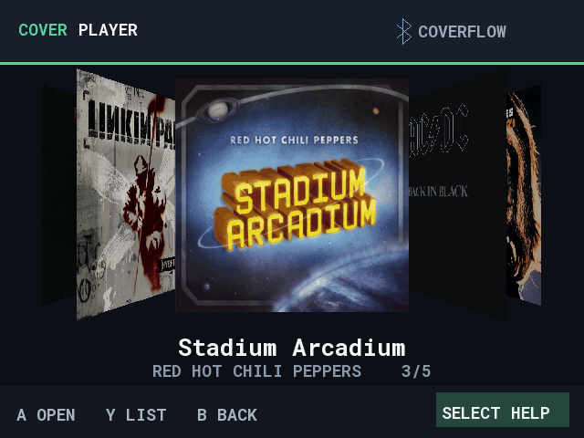

# CoverPlayer

**Offline MP3 player for handhelds.** Music, audiobooks and podcasts, controlled with buttons.

[Website](https://heilmic.github.io/CoverPlayer/) ·
[Download](https://github.com/heilmic/CoverPlayer/releases) ·
[Install & controls](packaging/README.md) · [Documentation](docs/README.md) ·
[Release notes](CHANGELOG.md)

## Features

- CoverFlow, lists and folder collections
- Resume, bookmarks, auto-next and sleep timer
- Album and per-track artwork
- Browse an album while listening
- Background playback and screen dimming on Knulli/muOS
- German and English interface

## Platforms

| Platform | Status |
| --- | --- |
| Knulli | Primary platform; **1.0.0 stable**. Optional [main-menu category](docs/knulli-category.md). |
| muOS | Library browsing and background playback. |
| [Switch / Switch Lite](packaging/switch/README.md) | **Alpha 5**, 1280 × 720 UI. Earlier Switch playback confirmed; alpha 5, Lite and docking checks pending. |

## Get started

1. [Install for Knulli/muOS](packaging/README.md#install) or [Switch](packaging/switch/README.md#install).
2. Press **Y** on the collection screen to add a media folder.
3. Press **A** to open it; **Select** (Switch: **Minus**) for help.

On Knulli/muOS, hold **Start** for two seconds during playback to listen in the background.

## Screenshots

[English gallery](docs/screenshots/generated/en/README.md) ·
[German gallery](docs/screenshots/generated/README.md) ·
[Switch previews](docs/switch.md#switch-display-layout)

Example media only; music and original covers are not bundled. [Artwork credits](docs/screenshots/demo-cover-sources.md).

## Development

C++17 / SDL2 · [Build & test](docs/development/README.md) ·
[Architecture](docs/architecture.md) · [Roadmap](TODO.md)

The main branch may be ahead of the downloadable release.

[Apache-2.0](LICENSE) · [Third-party notices](THIRD_PARTY_NOTICES.md) ·
[Support on Ko-fi](https://ko-fi.com/heilmic)
