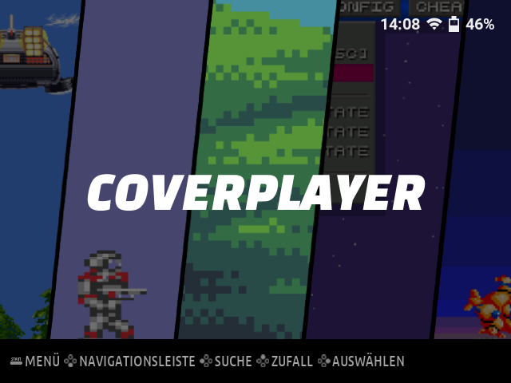
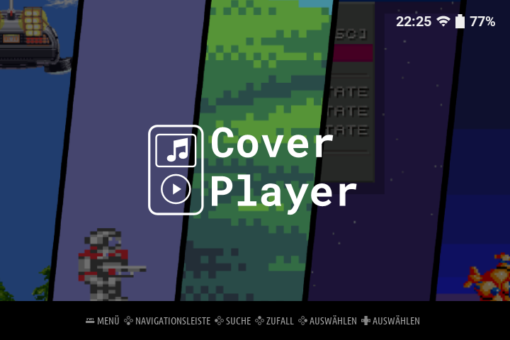

# CoverPlayer as a Knulli category

**Download `CoverPlayer-Knulli-Category.zip` from the
[release assets](https://github.com/heilmic/CoverPlayer/releases/latest).**
This is a complete alternative to `CoverPlayer-Knulli.zip`: the same regular
app, plus a dedicated CoverPlayer category on Knulli's main carousel.
You do not need to install both packages. It does not install CoverPlayer-Test.

## Install

1. Close CoverPlayer, including any background playback.
2. Extract the ZIP into Knulli's network share (`\\KNULLI\share`) or the
   mounted userdata partition. Merge the included `roms`, `system` and
   `theme-customizations` folders with the existing folders.
3. In Knulli, update the game lists. The CoverPlayer category contains one
   entry: select the category, then select CoverPlayer to start the app.

The existing Ports entry remains available. Both entries use
`roms/ports/CoverPlayer/` and the same saved settings, collections and progress.
CoverPlayer-Test remains separate. Installing this package over the regular
package updates that installation; it does not create another player copy.

## Category logo: Art Book Next

The category shows a white MP3-player symbol on the left and **Cover** / **Player**
on two lines on the right. It uses the normal logo area and keeps the theme's
background artwork. **System Logos → Custom is not required.**

The ZIP includes a small category-specific `roms/coverplayer/theme.xml` that
inherits the installed Art Book Next theme and overrides only CoverPlayer's
branding. It prefers an Art Book Next installation under `/userdata/themes`,
falling back to Knulli's bundled copy. It does not change global theme settings
or firmware files. The original SVG and outlined Roboto Mono Bold wordmark are
Apache-2.0; the logo needs no installed fonts.

This integration is for **Art Book Next**, Knulli's standard theme. If you use
another theme, remove `roms/coverplayer/theme.xml` so the category inherits your
selected theme again. Its logo integration depends on that theme. The standalone
`roms/coverplayer/coverplayer-logo.svg` can be reused; a compatibility copy remains
under `theme-customizations/art-book-next/logos/coverplayer.svg`.

## Remove only the category

Delete `system/configs/emulationstation/es_systems_coverplayer.cfg` and
`roms/coverplayer/CoverPlayer.sh` plus `roms/coverplayer/gamelist.xml`.
Remove `roms/coverplayer` if it is empty, then update the game lists.
The category-specific `theme.xml` and SVG can also be removed. Keep `roms/ports/CoverPlayer/`, its
Ports launcher, your media and saved application data.
