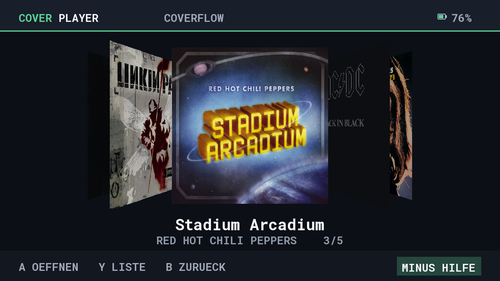
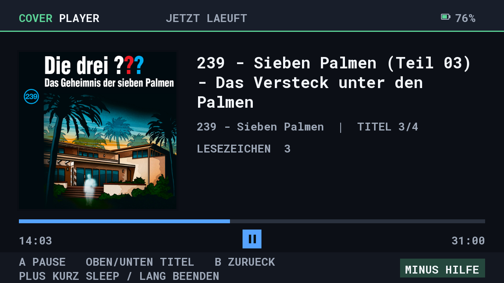

# Nintendo Switch alpha

**1.0.1 alpha 6** · [Installation, controls and hardware checklist](../packaging/switch/README.md)

- Foreground NRO for Switch and Switch Lite; shared MP3 player and collections.
- Collection creation and playback confirmed on Switch in alpha 2; alpha 5, Lite and docking validation pending.
- Volume and Bluetooth handled by the system; no custom dimming or Linux firmware helpers.
- Active playback inhibits auto-sleep. Focus loss pauses and saves; return resumes. Hardware verification pending.
- Applet-mode background playback reported; conditions and game compatibility remain unverified. No audio sysmodule bundled.

## Alpha 5 playback changes

- **B** returns to the track list while audio continues; leaving the album pauses and saves.
- One-track albums return directly to the browser and pause.
- Browsing selection stays independent of playback and auto-next; reopening the playing track does not restart it.
- Player prefers embedded track covers; album browser prefers folder covers.
- Older artwork caches rebuild once; collections and progress are retained.

## Build

Requires Docker and Python 3:

```powershell
./scripts/Build-Switch.ps1
```

- Uses the pinned official devkitPro image and `/opt/devkitpro/cmake/Switch.cmake`.
- Outputs `build/release/CoverPlayer-Switch-1.0.1-alpha6.{nro,zip,zip.sha256}`.
- ZIP includes installation files, licenses, application/decoder sources and relink recipe.
- Validates ELF/NRO structure, icon, version metadata, font and ZIP contents.
- Shared tests: `./scripts/Build-And-Test.ps1 -SkipPackages`.

## Switch display layout

| Setting | Switch |
| --- | --- |
| Canvas | 1280 × 720; uniform scaling when docked |
| Fonts | 28-point body / 40-point headings |
| CoverFlow | 400-pixel selected cover |
| Artwork cache | 16 entries, up to 512 × 512 pixels; about 16 MiB RGBA |

Knulli/muOS retain their separate renderer and dependencies. Desktop preview:

```powershell
cmake -S . -B build/switch-preview -G Ninja -DCMAKE_BUILD_TYPE=Release -DCOVERPLAYER_BUILD_TESTS=OFF -DCOVERPLAYER_BUILD_SWITCH_PREVIEW=ON
cmake --build build/switch-preview --target coverplayer_switch_preview
./build/switch-preview/coverplayer_switch_preview.exe build/switch-layout-review docs/screenshots/source-covers de
```

Desktop previews of the actual renderer; example covers are not bundled:




## Deploy over FTP

1. Close CoverPlayer; start ftpd and note its IP/port (often 5000).
2. Copy `scripts/deploy-switch.example.json` to `scripts/deploy-switch.local.json` (Git-ignored); enter connection details.
3. Run either command, then stop FTP and launch CoverPlayer:

```powershell
./scripts/Deploy-Switch.ps1          # upload existing build
./scripts/Deploy-Switch.ps1 -Build   # build, package and upload
```

- One-off connection: `-Address 192.168.10.123 -Port 5000`.
- Uploads only `/switch/CoverPlayer/CoverPlayer.nro`; verifies SHA-256 by downloading it again.
- Keeps `CoverPlayer.nro.previous`; attempts rollback on rename failure. Settings/media stay untouched.
- Fake-FTP tests: `python tests/switch_deploy_test.py`. Device connection testing remains separate.

## Ultrahand / Tesla background playback

Future work; no overlay or sysmodule is installed by this package:

- Persistent playback needs an independent audio sysmodule and an IPC control overlay.
- [Ultrahand](https://github.com/ppkantorski/Ultrahand-Overlay) supports Tesla overlays; [sys-tune](https://github.com/ppkantorski/sys-tune) provides an audio service with [IPC](https://github.com/ppkantorski/sys-tune/tree/master/ipc).
- Integration needs separate compatibility and lifecycle tests.

Toolchain: [devkitPro Docker](https://github.com/devkitPro/docker) ·
[libnx](https://github.com/switchbrew/libnx) ·
[Switch SDL2](https://github.com/devkitPro/SDL/tree/switch-sdl-2.28)
